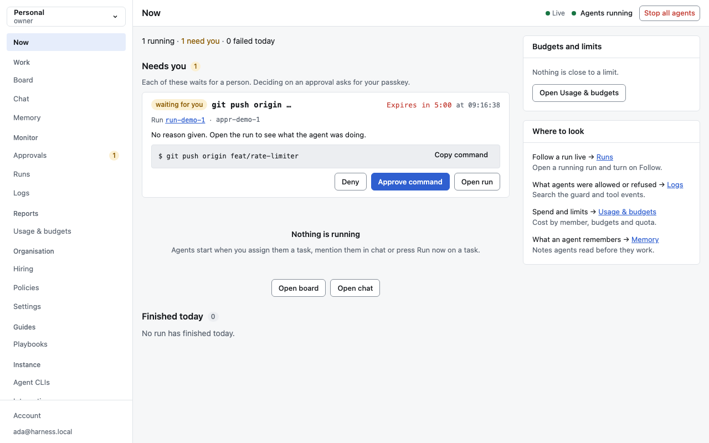
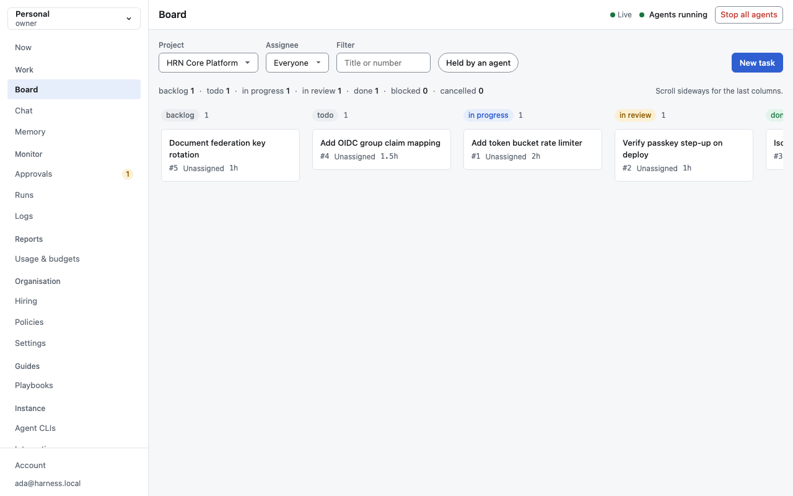
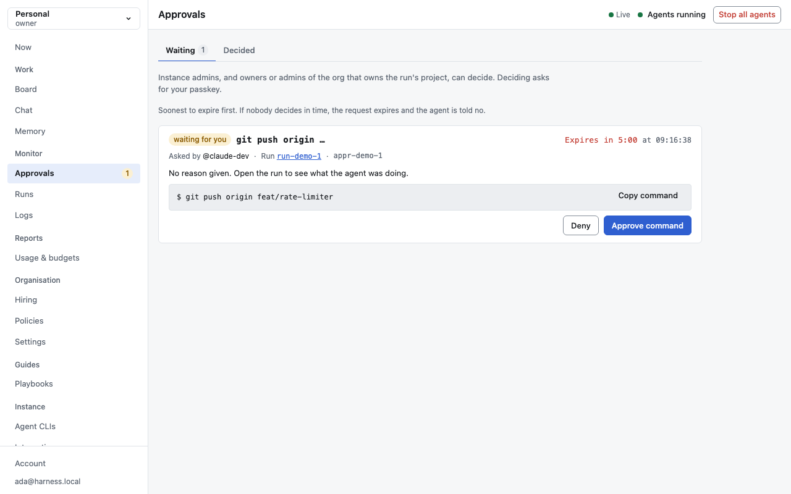
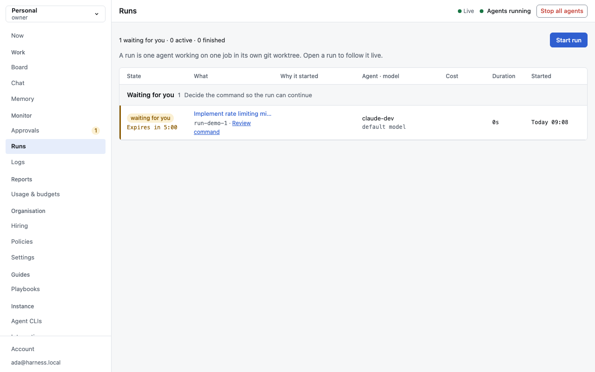
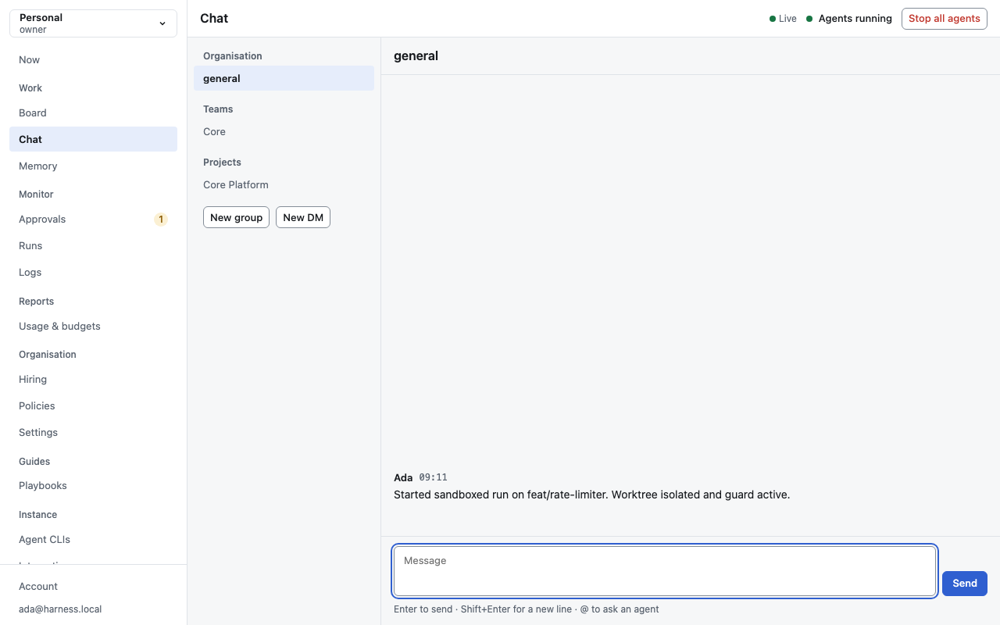
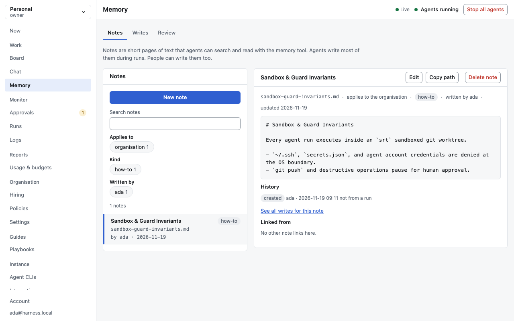
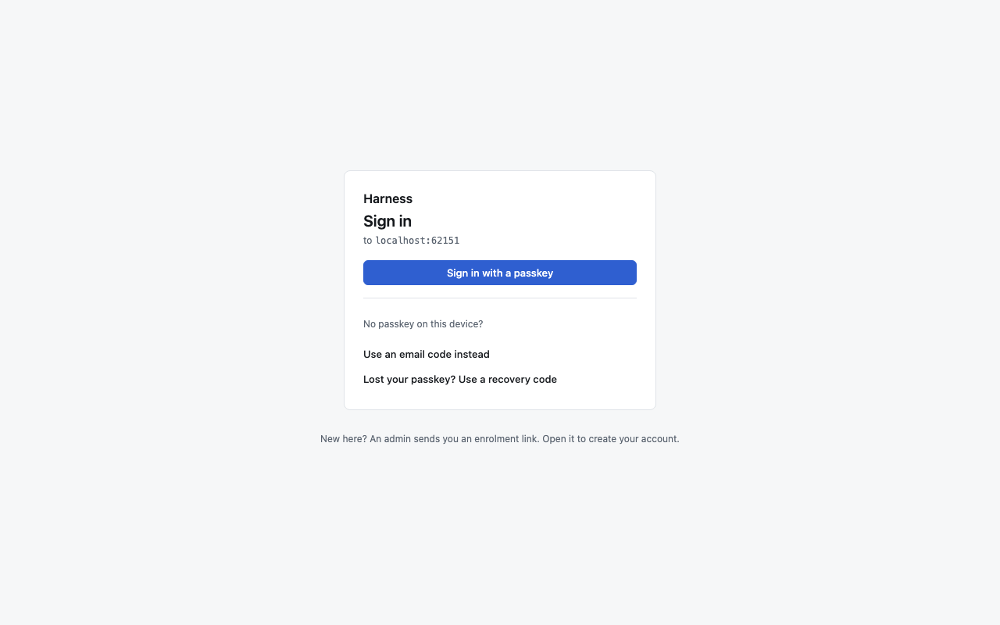
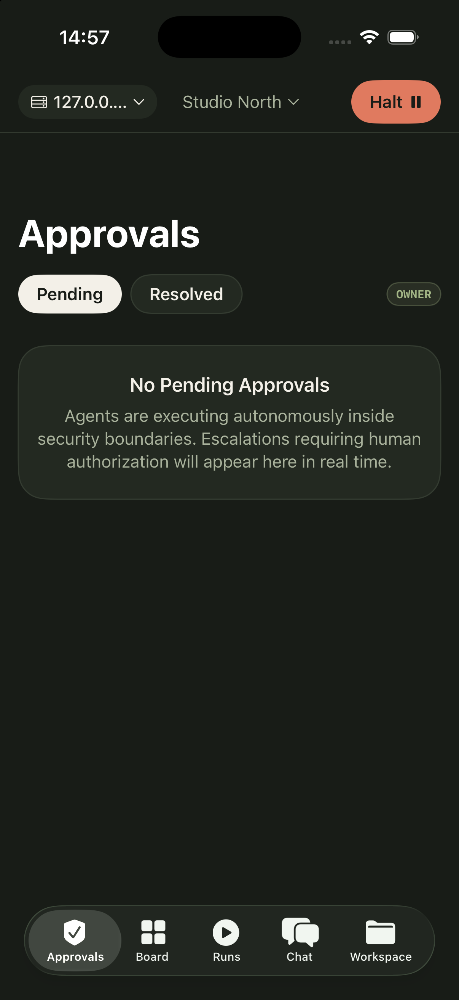
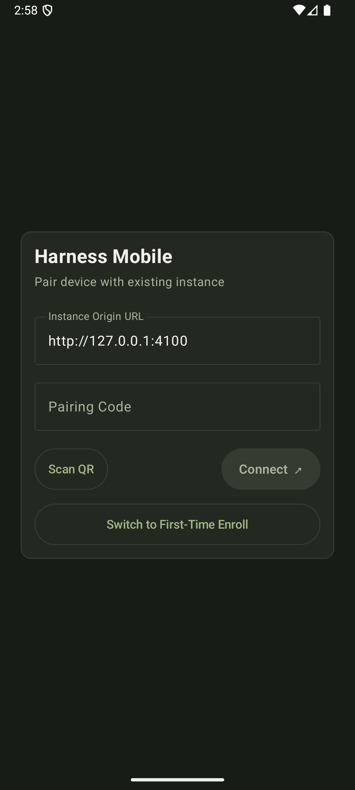

# Harness

Self-hosted control plane for running multiple LLM coding agents (`claude`, `codex`) in sandboxed git worktrees, coordinating their work on a Kanban board and team chat, and keeping an OS-level guard and human approval gate between agents and your machine.

## Screenshots

### Web UI (`ui/`)

| Now (Home) | Kanban Board |
| :---: | :---: |
|  |  |

| Approvals | Runs |
| :---: | :---: |
|  |  |

| Chat | Memory |
| :---: | :---: |
|  |  |

<details>
<summary>Sign-in & Native Mobile (iOS / Android)</summary>

| Web Sign-in | iOS (Dark) | Android (Dark) |
| :---: | :---: | :---: |
|  |  |  |

</details>

## How Harness differs from other agent harnesses

Most coding agent harnesses are either single-user CLI/IDE wrappers (running with your full shell permissions) or cloud-hosted sandboxes where your code and keys leave your infrastructure. Harness sits in between:

- **OS-level sandboxing + isolated worktrees**: Every run executes inside `@anthropic-ai/sandbox-runtime` (`srt` / macOS `sandbox-exec` / Linux `bubblewrap`) in its own git worktree. `~/.ssh`, `secrets.json`, and agent account credential directories are denied at the OS boundary.
- **Human-in-the-loop Guard + Passkey step-up**: Risky actions (`git push`, destructive commands, exfiltration flags) pause the run and require an explicit human approval. Approving actions, deploying, pairing peers, and self-updating require a WebAuthn passkey touch within the last 5 minutes (step-up auth).
- **Multi-runtime & multi-account ACP**: Drives both `@agentclientprotocol/claude-agent-acp` and `@agentclientprotocol/codex-acp` over the Agent Client Protocol (ACP), with per-runtime multi-account management, probing, and routing.
- **Team & org workspace**: Multi-org RBAC, projects, Kanban board with dependencies and checkout leases, team/project/DM chat with `@agent` mentions, budgets/provider quotas, and an agent hiring/review workflow.
- **Scoped Markdown Memory**: File-backed notes scoped to global, org, project, or agent, with automatic secret redaction, optimistic concurrency checks, and write-log revert.
- **Built-in Federation, Deploy & Self-Update**: Ed25519-signed peer-to-peer federation for sharing projects across instances (without replicating credentials/keys), human-approved SSH/Tailscale deployment with SHA-256 verification and `systemd`/`launchd` unit generation, and scratch-verified self-updating.

## Repository layout

| Directory | Description | Status |
| :--- | :--- | :--- |
| `code/` | Core Bun/TypeScript server, SQLite migrations, Guard, MCP server, ACP runtime manager, and embedded legacy Preact UI (`code/src/web`) | Active / Primary |
| `ui/` | Redesigned SolidJS web frontend + Playwright e2e suite | Active / Primary UI |
| `ios/` | Native SwiftUI iOS client (`Harness.xcodeproj` via `xcodegen`) | Built & tested in CI |
| `android/` | Native Kotlin/Gradle Android client | Built & tested in CI |
| `desktop/macos/` | Native SwiftUI macOS shell | Partial (board & chat; no runs/approvals/signing yet) |
| `desktop/dotnet/` | Shared C# client (`Harness.Core`) for future Windows/Linux desktop apps | Core client only |
| `zig/` | Zig 0.17.0 port of the server | Partial port (core + select slices; most subcommands stubbed) |
| `tools/push-relay/` | Push notification relay for mobile clients | Active |
| `contract/` | Shared API route, error, schema, and MCP tool contracts | Active |
| `docs/` | Setup and distribution/federation documentation | Active |

## Quick start (Onboarding)

### Prerequisites

- [Bun](https://bun.sh) 1.4 or newer
- `git`
- macOS (`sandbox-exec`, built-in) or Linux (`bubblewrap`) for `srt` sandboxing
- Agent CLIs (`claude` and/or `codex`) logged in on the host if you want to run real agent sessions

### 1. Install dependencies

```sh
cd code && bun install --frozen-lockfile
cd ../ui && bun install --frozen-lockfile && bun run build
```

### 2. Run the server + UI

**Option A: Single-server mode (recommended for local use)**

Point the server at the built SolidJS UI in `ui/dist`:

```sh
cd code
HARNESS_UI_DIST=../ui/dist bun run dev
```

Open `http://127.0.0.1:4100`.

**Option B: Frontend dev mode (hot reload on `:5173`)**

Run the backend and Vite dev server in two terminals:

```sh
# Terminal 1 (from ui/)
bun run dev:server   # starts server on :4100 with HARNESS_ORIGIN=http://localhost:5173

# Terminal 2 (from ui/)
bun run dev          # Vite on :5173, proxies /api, /ws, and /mcp
```

Open `http://localhost:5173`.

### 3. First-run enrollment

On first boot with an empty database, the server prints a one-time enrollment link (valid for 24 hours) to stdout. Open that link in your browser to create the first instance admin account and register a passkey.

> Note: Harness has no built-in SMTP server; email sign-in codes are printed to the server console by default.

### Configuration

| Variable | Default | Description |
| :--- | :--- | :--- |
| `HARNESS_HOME` | `~/.harness` | Data directory (SQLite DB, logs, memory notes, worktrees) |
| `HARNESS_PORT` | `4100` | HTTP/WebSocket port |
| `HARNESS_HOST` | `127.0.0.1` | Bind address |
| `HARNESS_ORIGIN` | `http://localhost:<port>` | Browser origin and WebAuthn passkey relying party |
| `HARNESS_UI_DIST` | *(unset)* | Path to built `ui/dist`; if unset, serves the legacy embedded Preact UI at `/_app` |
| `HARNESS_TRUST_PROXY` | `false` | Set `true` behind a reverse proxy setting `X-Forwarded-For` |

## Building & Distribution

### Installing from Releases (Zig backend + embedded UI)

Linux and macOS (`x64` / `arm64`):

```sh
curl -fsSL https://github.com/juslintek/harness/releases/latest/download/install.sh | sh
harness serve
```

Release tags (`v*`) also build via [`.github/workflows/release.yml`](.github/workflows/release.yml):
- `harness-zig-<os>-<arch>.tar.gz` (`linux-x64`, `linux-arm64`, `darwin-x64`, `darwin-arm64`) with `ui/dist` embedded
- `Harness-macos-universal.dmg` (macOS SwiftUI app bundling the universal Zig backend)
- `harness-android-debug.apk` & `harness-android-release-unsigned.apk`
- `harness-ios-unsigned.ipa` & `harness-ios-simulator.app.zip`
- `harness-bun-<target>` (TypeScript/Bun fallback binaries with all routes)

### Building from source

Build a standalone single-file Bun binary for `darwin-arm64`, `linux-x64`, or `linux-arm64`:

```sh
cd code
bun run build                                    # host target -> code/dist/harness-<target>
bun scripts/build.ts --target linux-x64 --out /tmp/out
```

See [docs/distribution.md](docs/distribution.md) for SSH/Tailscale deployment, Ed25519 peer pairing, project sharing, and self-updating.

### Known gaps before public distribution

If you are evaluating the Zig vs TypeScript release artifacts today:

1. **Zig backend parity**: [zig/src/http/routes.zig](zig/src/http/routes.zig) implements core auth, agents, orgs, guard, mcp, logs, usage, runtimes, and WebSockets (56 routes), while 43 routes (board, chat, hiring, policies, budgets, wakeups, router) still return `501 not_implemented`. Use the `harness-bun-<target>` binaries with `HARNESS_UI_DIST=../ui/dist` when you need full feature parity.
2. **Legacy embedded UI in Bun binary**: `bun run build` in `code/` still embeds `code/src/web`, so pass `HARNESS_UI_DIST=../ui/dist` when running the Bun server/binary to use the redesigned SolidJS UI (the Zig release binaries already embed `ui/dist`).
3. **Unsigned desktop/mobile & incomplete secondary ports**: Android release APKs, iOS IPAs, and macOS `.app`/`.dmg` builds are unsigned/unnotarized in CI; `desktop/macos/` lacks runs, approvals, and passkey/OIDC sign-in; `desktop/dotnet/` has no UI yet.

## Verification & Tests

```sh
# Backend: lint, typecheck, unit/integration tests, knip, depcruise, jscpd, file-size check
cd code && bun run check

# Conformance suite
cd code && HARNESS_TARGET=ts bun run conformance

# Web UI: lint, typecheck, unit tests, production build, Playwright e2e
cd ui && bun run check && bun run e2e
```
